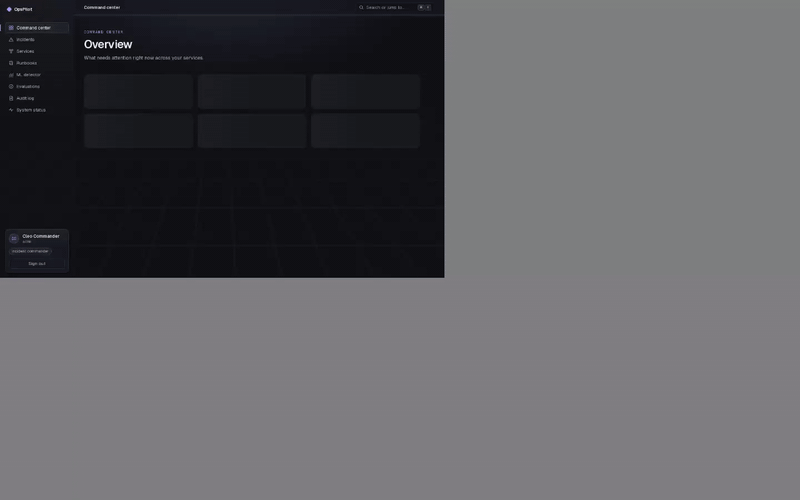
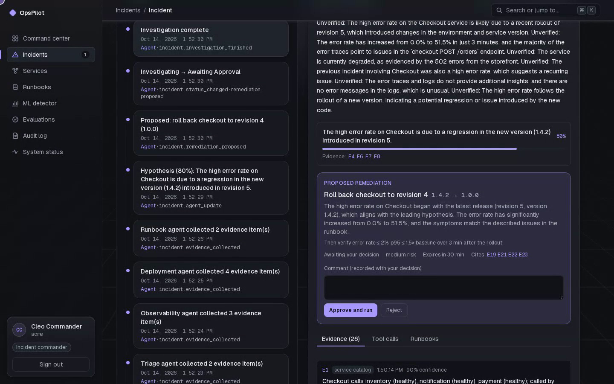
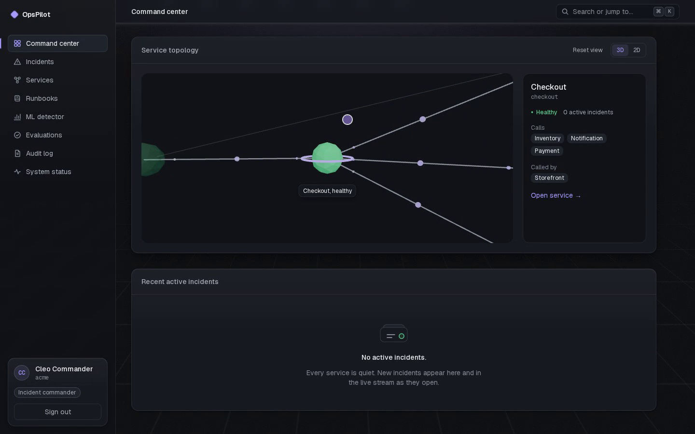
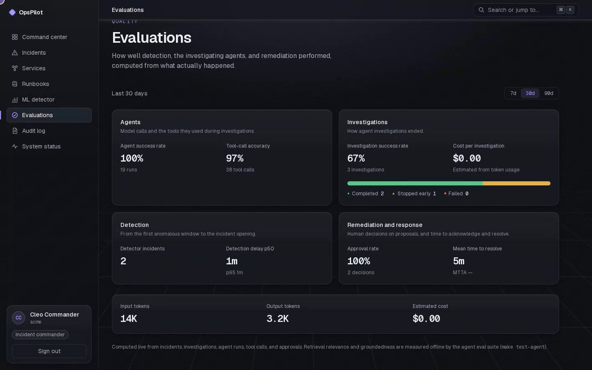
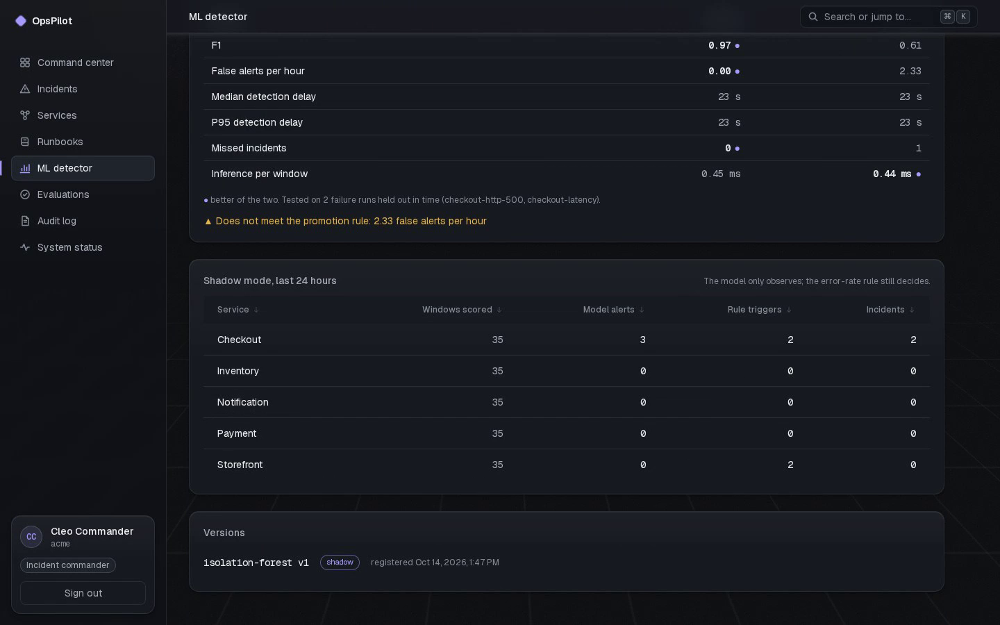
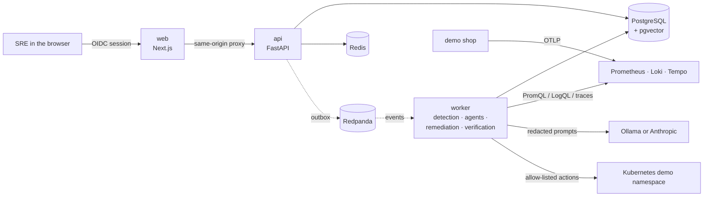

# OpsPilot

An AI-assisted Site Reliability Engineering platform. OpsPilot detects
incidents in a cloud application, investigates them with AI agents and
machine learning, proposes safe remediation, runs it only after a human
approves, verifies recovery, and writes the postmortem.

> **Status:** v1.0.1. The full incident loop works on the Kubernetes demo,
> hardened for production (rate limits, secure headers, alerts, backups,
> chaos and load tests, signed images, a release pipeline), with a
> redesigned interface, a threat model, a recorded walkthrough, and a
> landing page. Terraform for AWS is validated but has not been applied. See
> [known limitations](#known-limitations).



| | |
|---|---|
|  |  |
|  |  |

Recorded on the live demo with the local model; `make demo-record` and
`make demo-render` reproduce it. The project's landing page lives in
[`apps/landing`](apps/landing) (static, published to GitHub Pages;
`pnpm --filter @opspilot/landing dev`).

## Contents

[What it does](#what-it-does) · [Architecture](#architecture) ·
[Local development](#local-development) · [Demo and failure injection](#demo-stack-kubernetes) ·
[Cloud deployment](#cloud-deployment) · [Agent safety](#agent-safety) ·
[ML methodology](#ml-methodology) · [Testing](#test-strategy) ·
[Performance](#performance-results) · [Security](#security-model) ·
[Reliability](#reliability) · [Known limitations](#known-limitations) · [Roadmap](#roadmap)

## The incident loop

1. A faulty checkout release is deployed to the Kubernetes demo shop.
2. The detector sees the sustained error rate and opens exactly one
   incident, which appears live on the command center.
3. LangGraph agents investigate metrics, logs, traces, deployments, config
   changes, and commit metadata, read the matching runbook, and propose a
   rollback that cites its evidence.
4. An incident commander approves the exact proposal version. OpsPilot runs
   the allow-listed rollback once, verifies recovery against the
   pre-incident baseline, resolves the incident, and drafts the postmortem.
5. Every user, agent, and system action is in the audit log; the evaluations
   dashboard shows detection delay, agent outcomes, tool errors, tokens,
   cost, approval rate, MTTA, and MTTR.

Measured on the demo: detection in about 60–95 s, investigation in about
10 s, approval to rollback in 1 s, resolved 3 min 20 s later.

## What it does

- **Sign-in and access control:** OIDC through Keycloak (PKCE, tokens kept
  server-side), four roles enforced in the API, strict organization
  isolation, and a read-only user directory for administrators.
- **Incidents:** one state machine owns every status change, with optimistic
  locking, timeline events, audit records, filters, keyset pagination, and
  live updates over SSE that resume with `Last-Event-ID`.
- **Interface v2:** a dark, depth-layered design with purposeful motion:
  ⌘K command palette, animated live metrics, shared-element transitions from
  list to detail, a light that runs around the investigation panel while
  agents work, and a 3D service topology whose camera flies to the selected
  service (accessible 2D map and list fallbacks). Everything works without
  motion or WebGL and respects reduced motion. Lighthouse: 100 performance,
  100 accessibility on the measured pages.
- **Detection:** a worker evaluates every service's error rate against
  Prometheus with persistence, cooldown, and hysteresis; a sustained breach
  opens one incident on the failing service, callers are noted as affected,
  recovery is recorded.
- **Runbooks (RAG):** versioned Markdown runbooks chunked by section and
  embedded locally into pgvector; search filters by service and environment,
  cites runbook, version, and heading, and flags text that looks like prompt
  injection. Retrieval eval: top-1 and top-3 100 %.
- **Agent investigation:** triage → observability → deployments → runbooks
  → synthesis → remediation, with read-only tools over Prometheus, Loki,
  Tempo, Kubernetes, the catalog, and the runbook library. Runs on a local
  model (qwen2.5 7B via Ollama) by default or the Anthropic API.
- **Approval and safe remediation:** roll back, restart, scale within
  bounds, or pause a rollout, only in allow-listed namespaces, only after an
  incident commander approves the exact proposal version; executed once and
  verified.
- **Postmortems:** blameless drafts whose findings are labelled confirmed,
  strong or weak hypothesis, or unknown, each citing evidence.
- **ML anomaly detection:** labelled failure runs, versioned feature windows,
  a robust z-score baseline and an Isolation Forest evaluated
  chronologically in MLflow, running in shadow mode next to the rule.
- **Event-driven processing:** a transactional outbox published to versioned
  Redpanda topics; idempotent consumers with retries, dead-letter topics,
  replay, and W3C trace context. Investigation, remediation, and
  verification are event-driven whenever a broker is configured.
- **Delivery:** signed, scanned images with SBOMs, a hardened Helm chart,
  Argo CD with canary rollouts and smoke-test analysis, and a tag-driven
  release pipeline with a manual production gate.

## Architecture



| Part | Technology |
|---|---|
| Web (`apps/web`) | Next.js 16, React 19, TypeScript, Tailwind CSS 4, TanStack Query, Motion, React Three Fiber, zod + react-hook-form |
| API and worker (`apps/api`) | Python 3.12, FastAPI, Pydantic, SQLAlchemy, Alembic, LangGraph |
| Data | PostgreSQL 17 (pgvector), Redis, Redpanda (optional) |
| Identity | Keycloak (OIDC) |
| Typed client (`packages/api-client`) | Generated from the API's OpenAPI schema |
| ML (`ml/`) | pandas, scikit-learn, MLflow |
| Observability | OpenTelemetry, Prometheus, Alertmanager, Loki, Tempo, Grafana |
| Cloud | Terraform (AWS: VPC, EKS, Karpenter, RDS, ElastiCache, ECR, S3, Secrets Manager, Route 53, ACM, CloudTrail) |
| Delivery | Docker, Helm, Argo CD, Argo Rollouts, cosign, Kyverno, GitHub Actions |

More in [`docs/`](docs): [architecture overview](docs/architecture/overview.md),
[threat model](docs/threat-model/threat-model.md), [API reference](docs/api/reference.md),
[sample postmortem](docs/postmortems/sample-checkout-bad-release.md), [SLOs](docs/architecture/slos.md),
[ADRs](docs/adr), [interface spec](docs/design/interface-v2.md), and
[operations](docs/operations).

## Local development

Requirements: Docker, Node 22 with pnpm (via corepack), Python 3.12 with
[uv](https://docs.astral.sh/uv/), make.

```bash
cp .env.example .env      # change the *_PORT values if 5432/6379/8000/3000/8080 are taken
make install
make dev                  # PostgreSQL, Redis, Keycloak, API, and web; Ctrl+C stops all
```

Open the web app on `WEB_PORT` (default http://localhost:3000). The API's
readiness check is at `/api/v1/ready` on `API_PORT` (default 8000).

`make dev` also starts a local Keycloak (http://localhost:8080; admin console
login `admin` / `admin`) with the `opspilot` realm from
`infrastructure/keycloak/realm-opspilot.json`. Development users all use the
password `opspilot-dev`:

| User | Organization | Role |
|---|---|---|
| `viewer` | acme | viewer |
| `operator` | acme | operator |
| `commander` | acme | incident-commander |
| `admin` | acme | administrator |
| `outsider` | globex | administrator (for cross-organization tests) |

These credentials exist only in the local realm. `make token USER=commander`
prints an access token for API calls.

## Demo stack (Kubernetes)

The demo shop (storefront, checkout, payment, inventory, notification) runs on
a local [kind](https://kind.sigs.k8s.io/) cluster with OpenTelemetry,
Prometheus, Loki, Tempo, and Grafana. Requires `kind`, `kubectl`, and `helm`.

```bash
make deploy-local          # cluster, observability stack, demo image and chart
make seed                  # register the demo services in OpsPilot (API running)
make seed-runbooks         # load docs/runbooks into the runbook library (API running)
make load-normal           # steady synthetic traffic
make inject-failure SCENARIO=checkout-http-500   # ship a faulty release
make reset-demo            # back to the healthy release
make test-telemetry        # follow one request through traces, logs, and metrics
make test-detection        # one sustained failure → exactly one incident (needs make dev)
```

With `PROMETHEUS_URL` set, `make dev` also runs the **detection worker**. Every
15 s it evaluates each catalog service's error rate. A sustained breach opens
one incident on the failing service. Callers that fail because of it are
noted as affected on that incident instead of getting incidents of their own.
Recovery is recorded on the timeline.

The worker (`make worker`) also runs the **agent investigations**. Start the
local model once with `make llm-up` (Ollama, GPU when available). Detector
incidents are investigated automatically, and the incident page shows the
hypotheses, cited evidence, tool calls, and the proposed remediation.
`make test-agent LLM=ollama` runs the agent evals on the local model.

The cluster uses its own kubeconfig (`.kube/config`), so other clusters are
never touched. It publishes fixed localhost ports: Grafana
http://localhost:33300, Prometheus :39090, Loki :33100, Tempo :33200, and the
storefront :38080. Scenarios are described in
[`demo/failure-injection`](demo/failure-injection/README.md) and the stack in
[`observability`](observability/README.md).

## Cloud deployment

Terraform in [`infrastructure/terraform`](infrastructure/terraform/README.md)
describes development, staging, production, and a ttl-tagged load-test
environment: VPC across availability zones, private EKS with Karpenter, the
AWS Load Balancer Controller, cert-manager, and External Secrets, RDS
PostgreSQL, ElastiCache Redis, IRSA roles per workload, encrypted remote
state restricted to named principals, CloudTrail, and budgets.

```bash
make tf-check                       # fmt, validate, tflint, checkov (as CI)
make tf-plan ENV=development        # needs AWS credentials and backend.hcl
make infra-smoke ENV=development    # after apply: nodes, add-ons, secrets, database
```

Delivery is GitOps: merging to `main` builds, scans, signs, and pushes the
images, then moves the `env/development` tag that Argo CD follows; the API
and web roll out as 10/25/50/100 canaries with smoke-test and metric
analysis. Tagging `vX.Y.Z` runs the [release pipeline](.github/workflows/release.yml):
verify signatures and SBOMs, rerun every check, promote to staging, and
promote to production after manual approval. Roll back by moving the
environment tag back or with `kubectl argo rollouts abort`. On kind:
`make gitops-up`. Details: [`infrastructure/argocd`](infrastructure/argocd/README.md).

## Agent safety

The model never acts. It reads through a fixed set of read-only tools and
suggests; deterministic code decides.

- Tools are plain functions with schema-validated arguments, limited to
  allow-listed namespaces; there is no shell, SQL, or raw Kubernetes tool,
  and Secret values are never read.
- Retrieved runbooks and telemetry are marked untrusted; text that looks
  like an instruction is flagged and demoted. Adversarial runbooks are part
  of the evals.
- Hypotheses and summary claims must cite collected evidence; uncited
  claims are dropped or marked unverified, and unknowns are stated.
- A deterministic policy turns a suggestion into an allow-listed proposal
  with a risk level; an incident commander approves the exact version;
  execution is idempotent and re-checked just before acting.
- Prompts are redacted before every model call; every investigation has
  limits on rounds, tool calls, tokens, cost, retries, and duration, and
  degrades to a partial result that keeps its evidence.
- Evals (`make test-agent`): 9 investigation cases including prompt
  injection, with service, tool, runbook, and remediation accuracy 1.0,
  groundedness 1.0, and 0 unsafe proposals (scripted model in CI; run
  `make test-agent LLM=ollama` for the local model). See ADR-003.

## ML methodology

Labelled failure runs were recorded on the demo cluster and turned into
versioned feature windows (traffic, errors, latency percentiles, restarts,
availability). A robust rolling z-score baseline and an Isolation Forest are
trained and evaluated chronologically, holding out whole runs, tracked in
MLflow, and gated by a promotion rule. The model runs in shadow mode and is
compared with the rule and with real incidents on the ML detector page. On
the held-out runs the baseline wins (F1 0.97, no false alerts, 23 s delay
versus F1 0.62 for the Isolation Forest), so the model stays unpromoted.
Details and the report: [`ml/`](ml/README.md).

## Test strategy

| Layer | What it proves | Command |
|---|---|---|
| Unit (pytest, Vitest) | Domain rules, policies, adapters, components, contrast tokens | `make test` |
| Integration (Testcontainers: PostgreSQL, Redis, Redpanda) | Real queries, authorization (401/403/cross-org), idempotency, events, security boundaries | `make test-integration` |
| Contract | The typed client matches the OpenAPI schema | CI |
| End to end (Playwright) | User journeys on the full stack, plus visual regression snapshots of 11 pages | `make test-e2e` |
| Agent and retrieval evals | Accuracy, groundedness, injection resistance on fixed datasets | `make test-agent` |
| ML | Feature schema, leakage, determinism, reproducibility | `make test-ml` |
| Load (k6) | Latency targets for reads, writes, live streams, mixed load | `make test-load` |
| Chaos | Redis, Redpanda, PostgreSQL, API, worker, LLM, and Kubernetes failures | `make test-chaos` |
| Alert rules | Every alert fires and resolves as intended (`promtool`) | CI |
| Performance budgets | Lighthouse ≥ 85 performance, ≥ 90 accessibility; JS bundle budget | `make test-lighthouse`, CI |
| Security | gitleaks, Semgrep, pip-audit, pnpm audit, Trivy, checkov | CI |

Every pull request runs lint, types, unit, integration, contract, e2e,
Lighthouse, image scans, Helm and Terraform checks.

## Performance results

k6 against one API process on a shared, heavily loaded host (pessimistic;
[full report](docs/performance/load-test-results.md)):

| Scenario | p50 | p95 | p99 | Errors | Target |
|---|---|---|---|---|---|
| Reads, 50 req/s | 14 ms | 102 ms | 401 ms | 0 | p95 < 300 ms ✅ |
| Writes, 20 mutations/s | 19 ms | 31 ms | 36 ms | 0 | p95 < 500 ms ✅ |
| Live streams, 100 subscribers | — | — | — | 0 missed / 0 duplicated | reliable ✅ |

Load testing found that every committed event woke every stream with its
own database read; streams now share one read per wake-up.

## Security model

OIDC with server-side tokens; RBAC and organization filters on every route;
Redis-backed rate limits (429 with `Retry-After`); `Idempotency-Key` on
every mutation; secure headers and CSP on web and API with CORS off by
default; an append-only, redacted audit log enforced by the database; SQL
injection, stored XSS, SSRF, CSRF, and proxy-traversal tests in CI.
Kubernetes workloads run non-root with read-only root filesystems,
dedicated service accounts, minimal RBAC, and network policies; images are
digest-pinned, scanned, signed, and verified at admission by Kyverno. The
[threat model](docs/threat-model/threat-model.md) maps each threat to its
proving test and lists open risks.

## Reliability

- SLOs with burn-rate alerts and the required production alerts (API errors
  and latency, database pool, queue backlog and dead letters, agent
  failures, LLM cost, detection stopped, remediation failures, backups,
  certificates), each with a runbook: [alerts](docs/operations/alerts.md).
- Nightly database backups with a restore script; restore drill measured
  RTO 6.8 s and RPO 1.4 s locally (targets 4 h / 24 h):
  [drill](docs/operations/backup-restore-drill.md),
  [disaster recovery](docs/operations/disaster-recovery.md).
- Chaos suite: 7 failure scenarios pass; it found and fixed three real
  bugs (lease expiry during slow model calls, unbounded Kubernetes calls,
  500 instead of 503 while the database restarts):
  [results](docs/operations/chaos-results.md).

## Known limitations

- **No cloud deployment yet.** Terraform, the release pipeline, and Kyverno
  admission are validated statically and on kind only; no AWS account is
  configured.
- **The ML model is not promoted.** The statistical baseline beats the
  Isolation Forest on the recorded data; more failure scenarios (memory
  pressure, restarts, traffic spikes) and CPU/memory features are future work.
- **Agent evals in CI use a scripted model**; real-model quality varies and
  needs a GPU for the local model.
- **CSP allows inline scripts**, because Next.js partial prerendering does
  not support per-request nonces.
- **User management is read-only**; roles live in Keycloak.
- **Load numbers come from a shared, busy host**, not a dedicated
  environment.

## Roadmap

Each phase ends with a tagged release.

| Phase | Scope | Status |
|---|---|---|
| 0 | Planning and documentation | ✅ v0.2.0 |
| 1 | Local development foundation | ✅ v0.2.0 |
| 2 | Authentication, RBAC, audit logs | ✅ v0.2.0 |
| 3 | Service catalog and incident management | ✅ v0.3.0 |
| 4 | Modern UI and 3D service topology | ✅ v0.4.0 |
| 5 | Demo microservices and telemetry | ✅ v0.5.0 |
| 6 | Detection engine | ✅ v0.6.0 |
| 7 | Runbook retrieval (RAG) | ✅ v0.7.0 |
| 8 | Multi-agent investigation | ✅ v0.8.0 |
| 9 | Approval and safe remediation | ✅ v0.9.0 |
| 10 | ML anomaly detection | ✅ v0.10.0 |
| 11 | Event-driven processing | ✅ v0.11.0 |
| 12 | Cloud infrastructure (AWS, Terraform) | ✅ v0.12.0 |
| 13 | Containers, Kubernetes, and GitOps | ✅ v0.13.0 |
| 14 | Production hardening | ✅ v0.15.0 (shipped with phase 15; there is no v0.14.0) |
| 15 | Interface redesign | ✅ v0.15.0 |
| 16 | Launch readiness: docs, threat model, walkthrough, landing page | ✅ v1.0.0 |

## Repository layout

```
apps/api            FastAPI service, migrations, tests
apps/web            Next.js app and component tests
apps/landing        Static landing page (3D hero, GitHub Pages)
packages/api-client Typed API client generated from OpenAPI
demo/services       Instrumented demo shop (one image, five services) and load generator
demo/failure-injection  Faulty-release scenarios
infrastructure/     Keycloak realm, kind cluster, Helm charts, Terraform, Argo CD
observability/      Collector, Prometheus, Loki, Tempo, Grafana manifests and dashboards
tests/e2e           Playwright specs
ml/                 Datasets, training, evaluation report
tests/agent-evals   Agent and retrieval eval datasets
tests/performance   k6 load tests and Lighthouse budgets
tests/chaos         Fault-injection suite
docs/               Architecture, threat model, ADRs, SLOs, operations, design
scripts/            Development helpers
```

## Contributing

See [CONTRIBUTING.md](CONTRIBUTING.md).

## License

[MIT](LICENSE)
