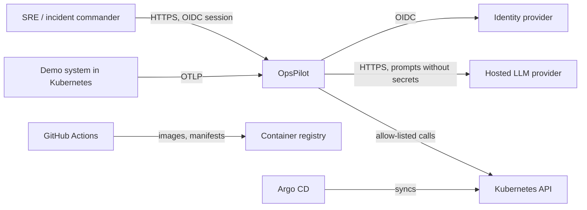
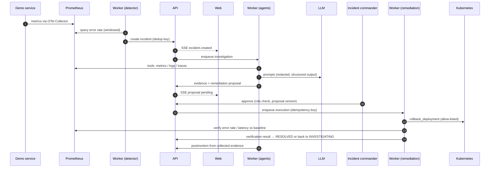
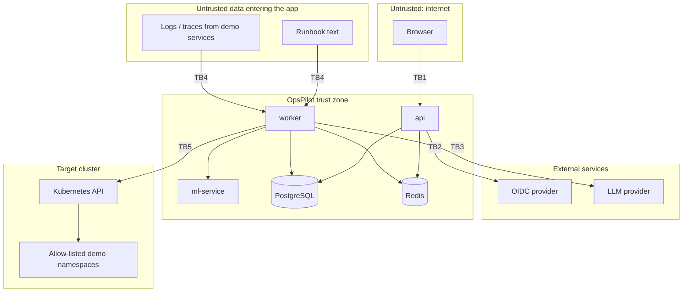

# Architecture Overview

Status: initial (Phase 0). Updated in the same PR as any change that moves a
component, a data flow, or a trust boundary.

## 1. System context

OpsPilot observes a demo microservice system, detects incidents, investigates
them with AI agents, and executes **only human-approved, allow-listed**
remediation against Kubernetes.

## 2. Components

| Component | Tech | Responsibility | Plan ref |
|---|---|---|---|
| `web` | Next.js, React, TanStack Query, R3F | UI, live timeline via SSE, approvals, dashboards | §6.1 |
| `api` | FastAPI, SQLAlchemy | AuthN/Z, CRUD, incident state machine, approvals, SSE, audit log, job submission | §6.2 |
| `worker` | Celery (one project, separate queues) | Telemetry queries, detection, agent orchestration (LangGraph), runbook ingestion, remediation, verification, postmortems | §6.3 |
| `ml-service` | FastAPI, scikit-learn, MLflow | Feature processing, anomaly scoring, model versions | §6.4 |
| PostgreSQL + pgvector | | System of record, embeddings | §12 |
| Redis | | Queue broker, cache, web sessions | §4.2 |
| Live updates | PostgreSQL `LISTEN/NOTIFY` → SSE | Commit-time incident notifications fanned out to streams (ADR-004) | §13 |
| Observability stack | OTel Collector, Prometheus, Loki, Tempo, Grafana | Telemetry for the demo system **and** OpsPilot itself | §4.4 |
| Redpanda | | Event bus — added in Phase 11 only | §15 |
| Demo system | storefront, checkout, payment, inventory, notification | Failure-injectable target | §6.5 |

The deployable unit count is deliberately small (see ADR-002).

## 3. Core incident flow

## 4. Trust boundaries

Every arrow that crosses one of these boundaries must authenticate, validate
input, and leave an audit or telemetry trail.

| ID | Boundary | Threats | Controls |
|---|---|---|---|
| TB1 | Browser → API | Stolen/forged tokens, IDOR, CSRF, XSS, request floods | OIDC token validation (iss/aud/exp/sig), RBAC on every route, tenant filter on every query, CORS allow-list, secure headers, rate limits, `X-Request-ID` + `Idempotency-Key` |
| TB2 | API ↔ OIDC provider | Token substitution, misconfigured audience | Pinned issuer and audience, JWKS caching with rotation |
| TB3 | Worker → LLM provider | Secret / PII leakage in prompts, provider outage, cost runaway | Redaction before every call, no secrets in prompts, timeouts and retries, per-incident token and cost budgets, prompt versioning |
| TB4 | Runbooks / telemetry → agents | Prompt injection, instructions disguised as data | Retrieved content marked untrusted, tool permissions enforced in code not prompts, schema-validated tool args, adversarial eval cases |
| TB5 | Remediation worker → Kubernetes | Destructive or out-of-scope actions, replayed approvals | Allow-listed actions only, namespace/resource allow-list, parameter bounds, human approval bound to proposal version, idempotent execution, dedicated least-privilege service account |
| TB6 | CI/CD → registry / cluster | Supply-chain compromise, leaked credentials | OIDC-federated CI credentials, signed images, SBOM, Trivy/Semgrep/Gitleaks, GitOps-only deploys |

Internal traffic between `api`, `worker`, `ml-service`, PostgreSQL and Redis
is inside the trust zone but still uses per-workload credentials and
Kubernetes network policies (plan §25).

## 5. Data ownership

- `api` owns all writes to incidents, approvals and audit logs. Workers
  report results through the same domain services, so every state
  transition goes through one code path (plan §13).
- Audit logs are append-only at the application level.
- Evidence stores summaries and source references; raw secrets never reach
  the database or the LLM.

## 6. Evolution

| Phase | Architectural change |
|---|---|
| 1–3 | `web` + `api` + PostgreSQL + Redis, synchronous flows |
| 5–6 | Demo system, observability stack, detector in `worker` |
| 7–9 | RAG, LangGraph agents, approval and remediation |
| 10 | `ml-service` in shadow mode |
| 11 | Redpanda; direct calls migrated to events one stage at a time |
| 12–13 | AWS (EKS, RDS, ElastiCache), Terraform, Argo CD, Argo Rollouts |
