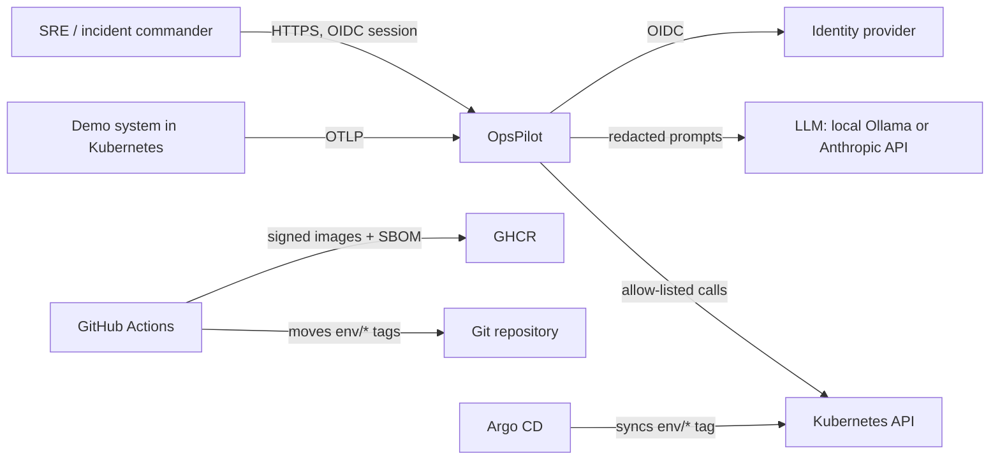
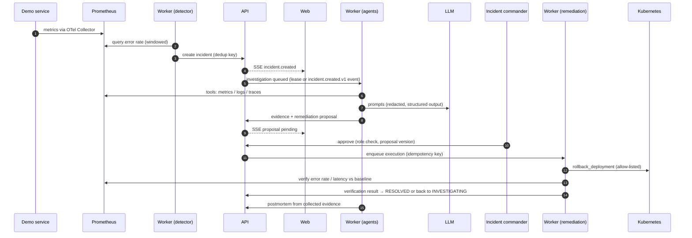
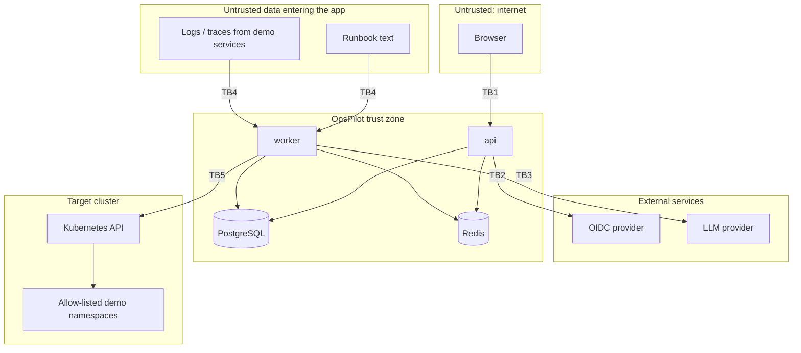

# Architecture Overview

Status: current as of v1.0 (phases 0–16). Updated in the same PR as any
change that moves a component, a data flow, or a trust boundary.

## 1. System context

OpsPilot observes a demo microservice system, detects incidents, investigates
them with AI agents, and executes **only human-approved, allow-listed**
remediation against Kubernetes.

## 2. Components

| Component | Tech | Responsibility |
|---|---|---|
| `web` | Next.js 16, React 19, TanStack Query, Tailwind 4, Motion, React Three Fiber | UI (interface v2), server-side OIDC session, same-origin API proxy, live timeline via SSE, approvals, dashboards, ⌘K palette, 2D/3D topology |
| `api` | FastAPI, SQLAlchemy, Alembic | AuthN/Z, incident state machine, approvals, SSE, audit log, evaluations, rate limits, idempotency, ML scoring endpoint, outbox |
| `worker` (`opspilot-worker`) | One asyncio process, PostgreSQL leases | Detection loop, ML shadow scoring, LangGraph investigations, remediation execution, recovery verification, postmortems; event consumers when Redpanda is configured |
| ML (`ml/`) | pandas, scikit-learn, MLflow | Offline dataset, training, and evaluation; the trained model is loaded in-process by the API/worker (no separate ML service) |
| PostgreSQL + pgvector | | System of record, runbook embeddings, job leases, transactional outbox |
| Redis | | Web sessions, API rate limits |
| Live updates | PostgreSQL `LISTEN/NOTIFY` → SSE | Commit-time incident notifications fanned out to streams; one read per wake-up shared by all subscribers (ADR-004) |
| Redpanda (optional) | Kafka API, aiokafka | Versioned event topics from the outbox; idempotent consumers with retries, dead-letter topics, and replay |
| Observability stack | OTel Collector, Prometheus, Alertmanager, Loki, Tempo, Grafana | Telemetry for the demo system and for OpsPilot; alert rules with runbooks |
| Demo system | storefront, checkout, payment, inventory, notification | Failure-injectable target on kind |

The deployable unit count is deliberately small (ADR-002): web, api, worker.
Background work is claimed from PostgreSQL with leases rather than a separate
queue broker, so a crashed worker's job is taken over after its lease expires.

## 3. Core incident flow

## 4. Trust boundaries

Every arrow that crosses one of these boundaries must authenticate, validate
input, and leave an audit or telemetry trail.

| ID | Boundary | Threats | Controls |
|---|---|---|---|
| TB1 | Browser → API | Stolen/forged tokens, IDOR, CSRF, XSS, request floods | OIDC token validation (iss/aud/exp/sig), RBAC on every route, tenant filter on every query, CORS allow-list, secure headers, rate limits, `X-Request-ID` + `Idempotency-Key` |
| TB2 | API ↔ OIDC provider | Token substitution, misconfigured audience | Pinned issuer and audience, JWKS caching with rotation |
| TB3 | Worker → LLM provider | Secret / PII leakage in prompts, provider outage, cost runaway | Redaction before every call, no secrets in prompts, timeouts and retries, per-incident token and cost budgets, prompt versioning |
| TB4 | Runbooks / telemetry → agents | Prompt injection, instructions disguised as data | Retrieved content marked untrusted, tool permissions enforced in code not prompts, schema-validated tool args, adversarial eval cases |
| TB5 | Remediation worker → Kubernetes | Destructive or out-of-scope actions, replayed approvals | Allow-listed actions only, namespace/resource allow-list, parameter bounds, human approval bound to proposal version, idempotent execution, dedicated least-privilege service account |
| TB6 | CI/CD → registry / cluster | Supply-chain compromise, leaked credentials | OIDC-federated CI credentials, digest-pinned base images, Trivy on every PR, cosign-signed images with SBOM attestations, Kyverno signature verification at admission, GitOps-only deploys via `env/*` tags |

Internal traffic between `api`, `worker`, PostgreSQL, Redis, and Redpanda
is inside the trust zone but still uses per-workload credentials and
Kubernetes network policies (plan §25).

## 5. Data ownership

- `api` owns all writes to incidents, approvals and audit logs. Workers
  report results through the same domain services, so every state
  transition goes through one code path (plan §13).
- Audit logs are append-only, enforced by the database.
- Evidence stores summaries and source references; raw secrets never reach
  the database or the LLM.

## 6. Evolution

| Phase | Architectural change |
|---|---|
| 1–3 | `web` + `api` + PostgreSQL + Redis |
| 5–6 | Demo system, observability stack, detector in `worker` |
| 7–9 | RAG, LangGraph agents, approval and remediation |
| 10 | ML detector in shadow mode (in-process, not a separate service) |
| 11 | Redpanda; investigation, remediation, and verification migrated to events (on by default when a broker is configured) |
| 12–13 | AWS (EKS, RDS, ElastiCache) in Terraform, Helm, Argo CD, Argo Rollouts |
| 14 | Production hardening: rate limits, secure headers, alerts, backups, chaos and load tests, release pipeline, Kyverno, Karpenter |
| 15 | Interface v2 |

See also: [threat model](../threat-model/threat-model.md), [SLOs](slos.md),
[alerts](../operations/alerts.md), [disaster recovery](../operations/disaster-recovery.md).
